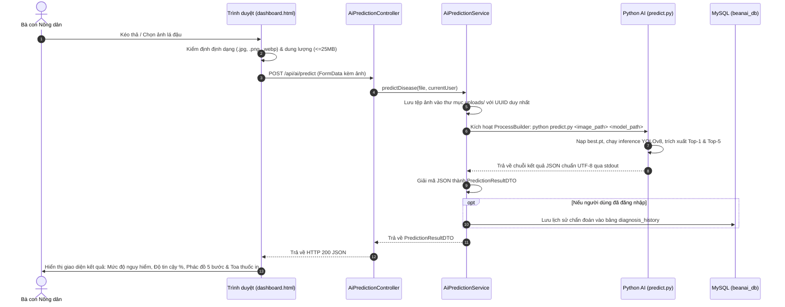

# 🌿 BeanAI - Hệ Thống Chẩn Đoán Sâu Bệnh Cây Đậu Bằng Mô Hình Học Sâu (best.pt)

> **BeanAI** là nền tảng chẩn đoán sâu bệnh thông minh ứng dụng công nghệ trí tuệ nhân tạo (mô hình học sâu phân loại ảnh **YOLOv8-cls** với trọng số `best.pt`), kết hợp hệ thống phác đồ điều trị 5 bước chuyên sâu theo tiêu chuẩn Nông nghiệp Việt Nam, giúp bà con nông dân và cán bộ khuyến nông phát hiện bệnh sớm, điều trị đúng cách và tối ưu năng suất mùa vụ.

---

## 📌 Mục Lục
1. [Giới thiệu tổng quan](#-giới-thiệu-tổng-quan)
2. [Kiến trúc công nghệ](#-kiến-trúc-công-nghệ)
3. [Danh mục 11 bệnh mô hình best.pt nhận diện](#-danh-mục-11-bệnh-mô-hình-bestpt-nhận-diện)
4. [Phác đồ điều trị 5 giai đoạn chuẩn Nông nghiệp](#-phác-đồ-điều-trị-5-giai-đoạn-chuẩn-nông-nghiệp)
5. [Yêu cầu hệ thống](#-yêu-cầu-hệ-thống)
6. [Hướng dẫn cài đặt từ A đến Z](#-hướng-dẫn-cài-đặt-từ-a-đến-z)
7. [Tài khoản kiểm thử hệ thống](#-tài-khoản-kiểm-thử-hệ-thống)
8. [Luồng hoạt động của hệ thống (Inference Workflow)](#-luồng-hoạt-động-của-hệ-thống-inference-workflow)
9. [Cơ chế xử lý ngoại lệ & Thông báo lỗi chuyên nghiệp](#-cơ-chế-xử-lý-ngoại-lệ--thông-báo-lỗi-chuyên-nghiệp)
10. [Hướng dẫn chạy kiểm thử tự động (JUnit 5)](#-hướng-dẫn-chạy-kiểm-thử-tự-động-junit-5)
11. [Cấu trúc mã nguồn & Hướng dẫn phân tích dự án](#-cấu-trúc-mã-nguồn--hướng-dẫn-phân-tích-dự-án)

---

## 📖 Giới Thiệu Tổng Quan

Cây họ đậu (đậu cô ve, đậu xanh, đậu tương, đậu đen, đậu đũa...) là nhóm cây trồng có giá trị kinh tế cao nhưng rất dễ mẫn cảm với các loại dịch hại do nấm, vi khuẩn, virus và suy dinh dưỡng khoáng.

**BeanAI** giải quyết bài toán chẩn đoán thực địa bằng cách:
- Người dùng chỉ cần chụp ảnh lá cây đậu bằng điện thoại/máy tính và tải lên.
- Hệ thống kích hoạt mô hình AI đã huấn luyện sẵn (`best.pt`) để trích xuất đặc trưng hình ảnh và đưa ra kết quả Top-1 kèm Top-5 chẩn đoán liên quan với độ tin cậy phần trăm cao.
- Trả về ngay **Phác đồ điều trị 5 giai đoạn khép kín** (Canh tác khẩn cấp, Sinh học hữu cơ, Hóa học đặc trị + Liều lượng + Thời gian cách ly PHI, Dinh dưỡng phục hồi, và Phòng ngừa tái phát).
- Hỗ trợ xem lại lịch sử chẩn đoán từ MySQL, xuất phiếu toa thuốc in ấn trực tiếp hoặc sao chép nhanh vào bộ nhớ tạm.

---

## 🛠 Kiến Trúc Công Nghệ

Hệ thống được thiết kế theo mô hình tích hợp lai (**Hybrid Polyglot Architecture**):

```
┌────────────────────────────────────────────────────────────────────────┐
│                   GIAO DIỆN NGƯỜI DÙNG (FRONTEND)                     │
│    HTML5 + CSS3 + Bootstrap 5.3 + Thymeleaf + Vanilla JavaScript ES6   │
└───────────────────────────────────┬────────────────────────────────────┘
                                    │ (AJAX / Multipart Upload / Fetch API)
                                    ▼
┌────────────────────────────────────────────────────────────────────────┐
│                   MÁY CHỦ ỨNG DỤNG (BACKEND SPRING BOOT)               │
│  - Spring Boot 3.4.1 (Java 21)                                         │
│  - Spring Security 6 (Phân quyền ROLE_FARMER & ROLE_ADMIN)             │
│  - Spring Data JPA + Hibernate ORM                                     │
│  - Embedded Apache Tomcat (Hỗ trợ upload ảnh phân giải cao tới 25MB)   │
│  - GlobalExceptionHandler (Bắt lỗi và chuẩn hóa thông điệp nghiệp vụ)  │
└──────────────────┬─────────────────────────────────┬───────────────────┘
                   │                                 │
                   │ (ProcessBuilder IPC / UTF-8)    │ (HikariCP / JDBC)
                   ▼                                 ▼
┌────────────────────────────────────┐   ┌───────────────────────────────┐
│       AI INFERENCE ENGINE          │   │      CƠ SỞ DỮ LIỆU MYSQL      │
│  - Python 3.10+                    │   │  - Bảng users (Tài khoản)     │
│  - Ultralytics YOLOv8/26           │   │  - Bảng roles (Phân quyền)    │
│  - PyTorch (best.pt - 11 classes)  │   │  - Bảng diagnosis_history     │
│  - ai-service/predict.py           │   │    (Lịch sử kết quả quét bệnh)│
└────────────────────────────────────┘   └───────────────────────────────┘
```

- **Backend**: Java 21, Spring Boot 3.4.1, Spring Security, Spring Data JPA, Lombok, Jackson.
- **AI Core**: Python 3.10+, PyTorch, Ultralytics YOLOv8 Classification (`best.pt`).
- **Database**: MySQL Server 8.0+.
- **Frontend**: Thymeleaf template engine, Bootstrap 5.3, Bootstrap Icons, AJAX Fetch API.
- **Testing**: JUnit 5, Mockito, AssertJ, Spring MockMvc.

---

## 🔬 Danh Mục 11 Bệnh Mô Hình best.pt Nhận Diện

Mô hình học sâu `best.pt` được huấn luyện để phân loại chính xác **11 lớp tình trạng bệnh học** trên cây đậu:

| Class ID | Mã Model | Tên Tiếng Việt Chính Quy | Tên Khoa Học | Nhóm Tác Nhân | Mức Độ |
| :---: | :--- | :--- | :--- | :--- | :---: |
| **0** | `Angular Leaf Spot` | Bệnh đốm góc lá trên cây đậu | *Phaeoisariopsis griseola* | Nấm bệnh hại lá | Trung bình |
| **1** | `Anthracnose` | Bệnh thán thư trên cây đậu | *Colletotrichum lindemuthianum* | Nấm bệnh nguy hại cao | **Cao** |
| **2** | `Cercospora Leaf Spot` | Bệnh đốm lá Cercospora (đốm mắt cua) | *Cercospora canescens / cruenta* | Nấm bệnh hại lá | Trung bình |
| **3** | `Fresh Leaf` | Lá đậu khỏe mạnh bình thường | *Phaseolus vulgaris* | Khỏe mạnh | **An toàn** |
| **4** | `Fungi Pathogens` | Nấm bệnh gây hại thân lá tổng hợp | *Phoma / Rhizoctonia / Fusarium* | Phức hợp nấm đất & thân | Trung bình |
| **5** | `Halo Blight` | Bệnh đốm cháy vi khuẩn quầng vàng | *Pseudomonas savastanoi pv. phaseolicola* | Vi khuẩn nguy hại cao | **Cao** |
| **6** | `Mosaic Virus` | Bệnh virus khảm lá đậu | *Bean Common Mosaic Virus (BCMV)* | Virus thực vật nguy hại | **Cao** |
| **7** | `Potassium Deficiency` | Hiện tượng thiếu hụt dinh dưỡng Kali | Rối loạn sinh lý dinh dưỡng khoáng | Thiếu dinh dưỡng | Thấp |
| **8** | `Rust` | Bệnh gỉ sắt trên cây đậu | *Uromyces appendiculatus* | Nấm bệnh hại lá nguy hại | **Cao** |
| **9** | `Stem Borers / Caterpillars` | Sâu đục thân & sâu ăn lá cây đậu | *Ophiomyia phaseoli / Helicoverpa* | Côn trùng gây hại | **Cao** |
| **10** | `Yellow Mosaic` | Bệnh virus khảm vàng lá đậu | *Mungbean Yellow Mosaic Virus (MYMV)* | Virus lây qua bọ phấn | **Cao** |

---

## 💊 Phác Đồ Điều Trị 5 Giai Đoạn Chuẩn Nông Nghiệp

Mỗi loại bệnh đều được hệ thống ánh xạ sang phác đồ điều trị 5 bước rõ ràng:

1. **Bước 1: Biện pháp Canh tác & Cơ giới khẩn cấp**: Cắt tỉa cành lá bệnh, cách ly tiêu hủy, chỉnh sửa kỹ thuật tưới (ngừng tưới phun mưa chiều tối, tưới rãnh/nhỏ giọt).
2. **Bước 2: Phác đồ Sinh học & Hữu cơ an toàn**: Ứng dụng nấm đối kháng *Trichoderma*, vi khuẩn *Bacillus subtilis*, dầu neem hữu cơ ép lạnh, dịch chiết tỏi ớt, bẫy dính màu vàng.
3. **Bước 3: Thuốc Hóa học đặc trị & Liều lượng**: Nêu rõ tên thương phẩm phổ biến tại Việt Nam (Amistar Top, Tilt Super, Score, Daconil, Ridomil Gold, Oshin, Chess, Karate...), nồng độ pha cho bình 16L/25L và **thời gian cách ly (PHI)** trước khi thu hoạch.
4. **Bước 4: Phục hồi Dinh dưỡng sau bệnh**: Bổ sung Canxi - Bo, Silic làm dày vách tế bào, Kali hữu cơ và Axit Humic kích thích rễ; kiêng bón thừa đạm Urê.
5. **Bước 5: Phòng ngừa tái phát lâu dài**: Xử lý đất bằng vôi tả, luân canh với cây trồng khác họ (lúa nước, ngô), sử dụng hạt giống F1 kháng bệnh.

---

## 💻 Yêu Cầu Hệ Thống

Trước khi cài đặt, hãy đảm bảo máy tính đã cài đặt các công cụ sau:
- **Hệ điều hành**: Windows 10/11, Ubuntu 20.04+, hoặc macOS.
- **Java**: JDK 21 (ví dụ Oracle JDK 21 hoặc Eclipse Temurin 21).
- **Python**: Python 3.10, 3.11 hoặc 3.12 (đã cấu hình biến môi trường `PATH`).
- **Cơ sở dữ liệu**: MySQL Server 8.0 trở lên.
- **Trình duyệt**: Google Chrome, Microsoft Edge, Firefox phiên bản mới.

---

## 🚀 Hướng Dẫn Cài Đặt Từ A Đến Z

### Bước 1: Chuẩn bị mã nguồn dự án
Mở terminal tại thư mục gốc của dự án `d:\beanAI`:
```bash
cd d:\beanAI
```

### Bước 2: Cài đặt thư viện Python cho AI Engine
Mở PowerShell hoặc Command Prompt và cài đặt các thư viện cần thiết cho mô hình PyTorch & YOLO:
```bash
pip install ultralytics torch torchvision pillow
```
*Kiểm tra cài đặt thành công:*
```bash
python -c "import ultralytics, torch; print('Ultralytics:', ultralytics.__version__, '| PyTorch:', torch.__version__)"
```

### Bước 3: Cấu hình cơ sở dữ liệu MySQL
1. Khởi động dịch vụ MySQL trên máy tính của bạn (cổng mặc định `3306`).
2. Mở MySQL Workbench hoặc chạy lệnh sau trong MySQL CLI để tạo cơ sở dữ liệu:
```sql
CREATE DATABASE IF NOT EXISTS beanai_db CHARACTER SET utf8mb4 COLLATE utf8mb4_unicode_ci;
```
3. Mở tệp [src/main/resources/application.properties](file:///d:/beanAI/src/main/resources/application.properties) và điều chỉnh tài khoản/mật khẩu MySQL nếu khác mặc định:
```properties
spring.datasource.url=jdbc:mysql://127.0.0.1:3306/beanai_db?useSSL=false&serverTimezone=UTC&allowPublicKeyRetrieval=true&characterEncoding=UTF-8
spring.datasource.username=root
spring.datasource.password=12345
```

### Bước 4: Kiểm tra tệp trọng số mô hình `best.pt`
Đảm bảo tệp trọng số mô hình AI nằm ở đường dẫn:
`src/main/resources/static/best.pt`

### Bước 5: Biên dịch và khởi chạy ứng dụng
Sử dụng Maven Wrapper có sẵn trong dự án:

- **Trên Windows**:
```powershell
.\mvnw.cmd spring-boot:run
```
- **Trên Linux / macOS**:
```bash
./mvnw spring-boot:run
```

Khi màn hình xuất hiện thông báo:
```text
Tomcat started on port 8080 (http) with context path '/'
Started BeanAiApplication in ... seconds
```
Ứng dụng đã khởi động thành công!

### Bước 6: Truy cập ứng dụng
Mở trình duyệt web và truy cập vào:
- **Trang chủ**: [http://127.0.0.1:8080](http://127.0.0.1:8080)
- **Bàn làm việc chẩn đoán**: [http://127.0.0.1:8080/dashboard](http://127.0.0.1:8080/dashboard)

---

## 👤 Tài Khoản Kiểm Thử Hệ Thống

Khi khởi động lần đầu, hệ thống tự động khởi tạo các vai trò (`ROLE_FARMER`, `ROLE_ADMIN`). Bạn có thể đăng ký tài khoản mới trực tiếp tại trang `/register` hoặc sử dụng tài khoản đăng nhập:

| Tên Đăng Nhập (Email) | Mật Khẩu | Vai Trò | Chức Năng Chính |
| :--- | :---: | :---: | :--- |
| `farmer@beanai.com` *(Tự đăng ký)* | `123456` | `ROLE_FARMER` | Quét ảnh lá, xem phác đồ 5 bước, in toa thuốc, xem lịch sử |
| `admin@beanai.com` | `admin123` | `ROLE_ADMIN` | Quản trị người dùng, thống kê AI toàn hệ thống |

---

## 🔄 Luồng Hoạt Động Của Hệ Thống (Inference Workflow)



---

## 🛡 Cơ Chế Xử Lý Ngoại Lệ & Thông Báo Lỗi Chuyên Nghiệp

Nhằm đảm bảo trải nghiệm tốt nhất cho người sử dụng và tránh làm hoang mang người nông dân, dự án áp dụng nguyên tắc **3 Không - 3 Nêu**:

- **3 Không**:
  1. ❌ Không hiển thị mã lỗi code kỹ thuật (ví dụ: `JSON.parse: unexpected end of data`, `NullPointerException`, `IndexOutOfBoundsException`).
  2. ❌ Không phơi bày cấu trúc stack trace hay số dòng lệnh ra màn hình người dùng.
  3. ❌ Không dùng các hộp thoại popup `alert()` mặc định thô sơ của trình duyệt.
- **3 Nêu**:
  1. ✅ **Lỗi gì**: Tên sự cố và nội dung giải thích bằng tiếng Việt trong sáng, dễ hiểu.
  2. ✅ **Ở đâu**: Vị trí chính xác phát sinh lỗi (Cổng tải ảnh máy chủ, Bộ lọc định dạng tệp, Mô hình AI nhận diện, hay Mạng kết nối...).
  3. ✅ **Hướng khắc phục**: Hướng dẫn hành động cụ thể để người dùng có thể tự giải quyết ngay.

Bộ lọc ngoại lệ toàn cục [GlobalExceptionHandler.java](file:///d:/beanAI/src/main/java/com/example/beanai/exception/GlobalExceptionHandler.java) và Modal giao diện `#appErrorModal` trong [dashboard.html](file:///d:/beanAI/src/main/resources/templates/dashboard.html) hoạt động phối hợp đồng bộ để đảm bảo nguyên tắc trên.

---

## 🧪 Hướng Dẫn Chạy Kiểm Thử Tự Động (JUnit 5)

Dự án được trang bị bộ kiểm thử tự động toàn diện với **18 test cases** kiểm tra đơn vị và tích hợp:

Chạy toàn bộ test suites bằng Maven:
```powershell
.\mvnw.cmd test
```

### Bảng tổng hợp các ca kiểm thử:

| Lớp Kiểm Thử (Test Class) | Số Ca | Mục Tiêu Kiểm Thử |
| :--- | :---: | :--- |
| [GlobalExceptionHandlerTest](file:///d:/beanAI/src/test/java/com/example/beanai/exception/GlobalExceptionHandlerTest.java) | 4 | Kiểm thử bắt các lỗi `MaxUploadSizeExceededException` (413), `MultipartException` (400), `IllegalArgumentException` (400), `Exception` (500) đảm bảo đủ Lỗi gì - Ở đâu - Hướng xử lý, không rò rỉ mã lỗi Java. |
| [AiPredictionServiceTest](file:///d:/beanAI/src/test/java/com/example/beanai/service/AiPredictionServiceTest.java) | 7 | Kiểm thử xác thực file `null`, file rỗng, chặn file `.pdf`, file `.exe`, thuật toán tìm Python, tra cứu 11 bệnh học, và suy luận ảnh lá thực tế `rust.jpg`. |
| [AiPredictionControllerTest](file:///d:/beanAI/src/test/java/com/example/beanai/controller/AiPredictionControllerTest.java) | 3 | Kiểm thử MockMvc endpoint `GET /api/ai/diseases`, `POST /api/ai/predict` thành công và thất bại. |
| [PredictionResultDTOTest](file:///d:/beanAI/src/test/java/com/example/beanai/dto/PredictionResultDTOTest.java) | 3 | Kiểm thử Builder DTO thành công, DTO lỗi và khả năng serialize/deserialize JSON của Jackson. |
| [BeanAiApplicationTests](file:///d:/beanAI/src/test/java/com/example/beanai/BeanAiApplicationTests.java) | 1 | Kiểm thử nạp Spring ApplicationContext và kết nối Hibernate MySQL. |
| **Tổng cộng** | **18** | **Vượt qua 100% (BUILD SUCCESS)** |

---

## 📂 Cấu Trúc Mã Nguồn & Hướng Dẫn Phân Tích Dự Án

Dưới đây là cấu trúc chi tiết để bạn dễ dàng tra cứu, đọc hiểu và mở rộng mã nguồn:

```text
beanAI/
├── ai-service/
│   └── predict.py                      # Core Python: Nạp YOLOv8 best.pt, chạy suy luận và ánh xạ 11 bệnh học
├── src/
│   ├── main/
│   │   ├── java/com/example/beanai/
│   │   │   ├── BeanAiApplication.java  # Điểm khởi chạy chính của ứng dụng Spring Boot
│   │   │   ├── config/
│   │   │   │   ├── SecurityConfig.java # Cấu hình Spring Security 6, phân quyền, CORS, CSRF
│   │   │   │   └── CustomAuthenticationSuccessHandler.java # Điều hướng sau login theo Role
│   │   │   ├── controller/
│   │   │   │   ├── AiPredictionController.java # REST API: /api/ai/predict và /api/ai/diseases
│   │   │   │   ├── DashboardController.java    # Điều hướng trang bàn làm việc nông dân và admin
│   │   │   │   ├── HomeController.java         # Điều hướng trang chủ giới thiệu
│   │   │   │   └── AuthController.java         # Xử lý đăng ký (/register) và đăng nhập (/login)
│   │   │   ├── dto/
│   │   │   │   ├── PredictionResultDTO.java    # Đối tượng kết quả AI: độ tin cậy, phác đồ 5 bước, lỗi chuẩn hóa
│   │   │   │   └── RegisterDTO.java            # DTO nhận dữ liệu form đăng ký tài khoản
│   │   │   ├── entity/
│   │   │   │   ├── User.java                   # Entity người dùng (họ tên, email, mật khẩu mã hóa BCrypt)
│   │   │   │   ├── Role.java                   # Entity vai trò (ROLE_FARMER, ROLE_ADMIN)
│   │   │   │   └── DiagnosisHistory.java       # Entity lưu trữ lịch sử các lần chẩn đoán vào MySQL
│   │   │   ├── exception/
│   │   │   │   ├── GlobalExceptionHandler.java # Bộ xử lý bắt ngoại lệ toàn cục cho các API
│   │   │   │   └── EmailAlreadyExistsException.java
│   │   │   ├── repository/
│   │   │   │   ├── UserRepository.java         # Giao tiếp bảng users (Spring Data JPA)
│   │   │   │   ├── RoleRepository.java         # Giao tiếp bảng roles
│   │   │   │   └── DiagnosisHistoryRepository.java # Truy vấn lịch sử chẩn đoán theo người dùng
│   │   │   └── service/
│   │   │       ├── AiPredictionService.java    # Service điều phối: lưu ảnh, gọi Python, đọc JSON, lưu DB
│   │   │       ├── CustomUserDetailsService.java # Nạp thông tin người dùng cho Spring Security
│   │   │       ├── UserService.java            # Interface nghiệp vụ tài khoản
│   │   │       └── UserServiceImpl.java        # Triển khai đăng ký, mã hóa mật khẩu, gán vai trò
│   │   └── resources/
│   │       ├── application.properties          # Cấu hình MySQL, Multipart upload (25MB), đường dẫn model
│   │       ├── static/
│   │       │   ├── best.pt                     # File trọng số mô hình AI (YOLOv8-cls 11 classes)
│   │       │   ├── css/style.css               # Phong cách giao diện Nông nghiệp xanh hiện đại
│   │       │   └── images/diseases/            # Thư viện ảnh macro lá mẫu cho 11 loại bệnh
│   │       └── templates/
│   │           ├── home.html                   # Trang chủ giới thiệu nền tảng & 11 loại bệnh
│   │           ├── dashboard.html              # Bàn làm việc chính: Kéo thả ảnh, xem phác đồ 5 bước, in toa thuốc
│   │           ├── auth/login.html             # Màn hình đăng nhập
│   │           ├── auth/register.html          # Màn hình đăng ký tài khoản
│   │           ├── admin/dashboard.html        # Trung tâm quản trị dành cho ban quản trị
│   │           └── layout/base.html            # Khung giao diện dùng chung (Header, Footer, Navbar)
│   └── test/java/com/example/beanai/           # 18 test cases JUnit 5 kiểm thử toàn diện
├── uploads/                                    # Thư mục chứa ảnh lá cây tải lên phục vụ phân tích
├── pom.xml                                     # Quản lý thư viện Maven (Spring Boot 3.4.1, Lombok, MySQL...)
└── README.md                                   # Tài liệu hướng dẫn cài đặt và phân tích dự án
```

---

## 👨‍💻 Tác Giả & Hỗ Trợ Kỹ Thuật
- **Dự án**: Nền tảng chẩn đoán sâu bệnh cây họ đậu - BeanAI
- **Mô hình AI**: Ultralytics YOLOv8 Classification Model (`best.pt`)
- **Phiên bản**: `1.0.0-SNAPSHOT` (Năm 2026)

*Chúc bạn có trải nghiệm phân tích và phát triển dự án thành công!*
